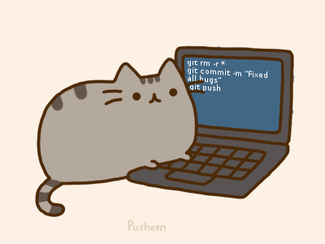

# Hi 👋, Nice to meet you!

### I'm OneLostCat 🐱
- 🔭 A computer enthusiast & Special developer from China.
- 🌱 Currently studying in Wuhan, China.
- 📫 You can contact me here 👉 [onelostcat@outlook.com](mailto:onelostcat@outlook.com)
- ⭐ You may like [👉iKun👈](https://lostcat.cc/file/video/蔡徐坤.mp4)
- ⚡ Fun fact: Chicken you're so beautiful!

### 🛠 Tech Stack

<!--
**OneLostCat/OneLostCat** is a ✨ _special_ ✨ repository because its `README.md` (this file) appears on your GitHub profile.

Here are some ideas to get you started:

- 🔭 I’m currently working on ...
- 🌱 I’m currently learning ...
- 👯 I’m looking to collaborate on ...
- 🤔 I’m looking for help with ...
- 💬 Ask me about ...
- 📫 How to reach me: ...
- 😄 Pronouns: ...
- ⚡ Fun fact: ...

https://github.com/kautukkundan/Awesome-Profile-README-templates/blob/master/elaborate/JoeyBling.md
-->
